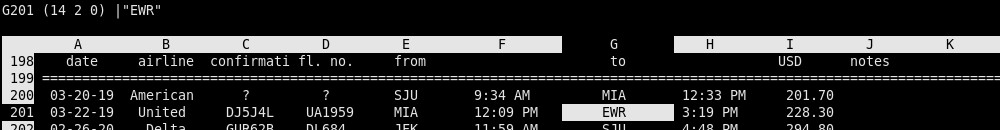

Here's some notes on how to use the 1980s classic spreadsheet program `sc`, and
why. We'll start with the usage basics, then discuss the limitations and comment
on the user experience.

### Basic Usage

Install it from your favorite package manager (`sudo apt install sc`) or build
the latest version yourself:

```
git clone https://github.com/n-t-roff/sc.git
cd sc
./configure
make
sudo make install
```

Launch `sc` and you'll have a spreadsheet in milliseconds---likely faster than
your finger can leave the Enter key.

**Navigation.** To move around, use the arrow cells or the `hjkl` keys familiar
from Vim and similar programs. To quit, press `q`. To save, press `P`.

**Text Entry.** Free-form text can be inserted in the current cell using `<` for
left-aligned text, `>` for right aligned, and `\` for centered. To change
alignment subsequently, navigate to the cell and press `{` or `}` to left or
right align, and `|` to center.

**Annotations.** Instead of adding hidden notes to cells, in `sc` one adds links
to other cells. (I tend to place these notes in the rightmost column, so they do
not clutter the main data.) To add a link, press `*a`, navigate to the target
cell, and press Enter twice. Press `**` to jump from the original cell to the
linked target cell. Simple!

**Numerical Values.** Press `=` and enter a number or a formula. Special
functions start with `@`, for example entering `@now` will enter the current
Unix time. To enter a specific date, use `@dts(2026,11,30)`.

**Cell Format.** Press `F` to set the format string for the current cell. The
manual details the format, but in practice I use this most commonly to make one
cell (or a few cells) format a date/time value. I use the format string
`^D%m/%d/%y`, where `^D` is the literal Ctrl-D character (ASCII 0x04, "end of
transmission").

**Column Format.** Press `f` and use the arrow keys or `hjkl`: left/right (or
`h`/`l`) to make the column narrower or wider; up/down (or `k`/`j`) to increase
or decrease the number of decimal places.

For more flexibility, press `f` followed by a digit: `f0` is the default, `f1`
formats numbers in scientific notation like `1.00E+04`, `f2` is the same in
engineering notation (`10.00e+03` such that the exponential is a multiple of
three), `f3` and `f4` format dates as `5 Nov 26` and `5 Nov 2026`, resp. To
define a custom numerical format, open spreadsheet in the text editor and enter
a line like

```
format 5 = "^D%m/%d/%y"
```

Careful: if you want the date formatting to work correctly, the `^D` must be the
literal end-of-transmission character, *not* a caret followed by uppercase D.

**Rows/Cols.** To insert new rows or columns, type `ir` or `ic` respectively. To
delete rows or columns, type `dr` and `dc`. As with most commands, you can
precede it with a number; for example, `5ir` inserts five rows. Careful when
deleting multiple rows, there is no undo! Save the sheet first, before making
large deletions.

**Ranges.** To operate on several cells at once, use the range
commands that start with `r`. There are several range commands but I only use
four:

- Delete a range: type `rx` then use motion commands (such as the arrow keys) to
  select the range, followed by Enter.
- Convert formulas to values: `rv` + motion + Enter and the formulas are
  replaced with their numeric values.
- Copy a range: navigate to the *destination* cell and type `rc` followed by
  spacebar. Then use motion commands to navigate to the first cell in the source
  range. Press `.` (period) to begin range selection. Press Enter to execute the
  copy.
- Move a range: starting on the destination cell, type `rm`. Then go to the
  source, press `.` (period), select the range you moved moved, and press Enter
  to execute the move.

**Copy/Cut/Paste**. Besides the range copy and move commands explained just
above, it is also possible to operate on a single cell, or one or more rows or
columns, as follows:

| Object    | Copy  | Delete | Paste  |
| --------- | ----- | ------ | ------ |
| Cell      | `yy`  | `x`    | `pp`   |
| Row       | `yr`  | `dr`   | `pr`   |
| Column    | `yc`  | `dc`   | `pc`   |

**Marks and Jumping.** When working on two parts of the spreadsheet that are far
apart, for example when copying and pasting, or moving things around, it helps
to give cells a temporary "mark". To mark a cell, press `m` followed by any
other lowercase letter, for example `ma`. To jump to a cell previously marked in
this way, press backtick followed by the same lowercase letter.

To copy the marked cell, mark it, navigate somewhere else, and press `c`
followed by the letter. Even though one can copy and paste a single cell using
`yy` and `pp` as explained above, I got used to copying with `ma` and `ca`
instead (Y is far away from fingers on QWERTY keyboards).

Type Ctrl-A to jump to cell `A0`.

**Scrolling.** To scroll the sheet down, press Ctrl-e followed by Ctrl-e
(again). To scroll up, press Ctrl-y. To scroll such that the current cell
becomes the top row, press `z` followed by Enter. To center the current cell,
press `zc`.

**Searching.** To search for a particular string (case sensitive), type `g"`
followed by the desired string. To repeat the search without re-typing the
string, press `n`. To repeat the search in the backwards direction, type `N`.

**Colors.** There are a number of commands to set the color of cells.  I do not
remember what these are. Instead, I open the spreadsheet file in a text editor,
and simply add the following self-explanatory lines:

```
set color
color 1 = @white;@black
color 2 = @black;@green
color A1:C4 2
```

**Frames.** Set a frame if you want one part of the spreadsheet to scroll
independently of another. I use this to have the table header with column names
always visible, even when scrolling through many pages of data rows. There are
many commands for manipulating frames and as with colors, I do not remember any
of them. Instead, open the spreadsheet in a text editor and add a line like

```
frame A0:N1000 B3:N1000
```

This sets the first three lines to be the fixed header, while the rest scrolls
freely.

**Function keys.** To use shortcuts, the function keys (F1 through F12) can be
given custom actions, such as motion commands or calling macros. For example:

```
fkey 4 = "endright"
fkey 11 = "merge \"|~/projects/config/scmacros/copy_above.sh\""
```

**Macros.** To convert a complex sequence of keystroke into a single keypress,
define macros. These are simple shell scripts such as the
[`copy_above.sh`](https://github.com/js216/config/blob/tulien/scmacros/copy_above.sh)
that I have mapped to F11: it moves one cell up and one cell right, copies the
cell, then moves one cell down to paste it. To create your own, take a look at
[my macros](https://github.com/js216/config/tree/tulien/scmacros), or, better
yet, point your favorite AI at the cloned `sc` repo and tell it to write it for
you.

Technically `sc` distinguishes "simple" macros, which are interpreted by `sc`
itself, and `advanced` macros, which are shell filters. However, the advanced
macros can do anything the simple ones do, so I never used the simple ones.

**Config file.** Common settings that you want applied by default to all
spreadsheets can be placed in the `~/.scrc` file. Rather than reading this file
in addition to the spreadsheet file, `sc` will place the content of `scrc` into
all newly created spreadsheets. In my
[`scrc`](https://github.com/js216/config/blob/tulien/scrc), you will find only
the `format 5` definition and a couple function key shortcuts.

### Limitations

A key part of the `sc` experience lies in the features that are *not* present.
Of course, you could add any of these with AI, or look at projects like
[`sc-im`](https://github.com/andmarti1424/sc-im) but in this instance I choose
to "embrace the constraint" instead, to see what I can learn from it.

**No Sync.** Instead of every change being reflected on the cloud, I sync the
sheets I want to sync by adding them to a git repo. Works great since the file
format is text-based and very simple.

**No Multiple Sheets.** I was used to grouping several related sheets in one
file, but after `sc`-ing for a while, this makes no more sense to me than
bundling several source code files in one. The file system works great for
organizing files---why does it seem like people are suddenly afraid of using
files? Why do Apple and Google go to such lengths to hide it from users?

**Limited Conditional Formatting.** I love making sheets automatically get
colored based on data values but in retrospect it's a huge distraction. Why not
make the data speak for itself instead? (There are some commands that can change
cell color, but I do not find it useful enough to learn.)

**UI is not Discoverable.** You cannot figure out how to do things, or even if
something is possible, except by reading the manual and/or source code. The
learning code feels steep but for a program I use every day, it totally does not
matter. I have it all in finger memory and I'm glad there's not "beginner
friendly" menus, popups, AI chats slowing me down.

**Limited External Copy/Paste.** It's nice to copy a table from a web page
seamlessly into a spreadsheet but here you have to import it with a text editor,
or Python script, or Claude. No CSV in/out either, without external tools. In
other words, use the right tool for the right job. Does one program really have
to do everything? For me, the [key insight of
Unix](https://embd.cc/unix-contributions) is the partitioning of tasks into
separate small programs, even if sometimes at the cost of slight inconvenience.

**No Undo/Redo.** Instead, I keep  history with git, and make sure to save
before and after making edits. If I make a mistake, just quit and reopen the
program: `qn`, Up, Enter. Four keystrokes and it's undone. (Usually Ctrl-Z
in Google Sheets takes longer to execute, amazingly.)

**No Unicode.** I live in ASCII.

### Discussion

In light of these limitations, why bother with `sc`? Isn't old software
obsolete, by definition of "old"? I disagree. If a program worked well on
ancient computers a long time ago, then on modern machines it will work even
better. The `sc` user experience is *just so fast* it blew me away. There is
simply no waiting; everything happens instantaneously: opening/closing the
program, entering data, making edits.

Conversely, if a piece of software---indeed any technical project--is worth
implementing, it's worth doing it right so it can stand the test of time. Sure,
some tech is necessarily disposable, if it interfaces with some frequently
changing protocols, for example. But most problem domains allow decomposition
into *small tools*, where the tool remains essentially unchanged over decades.

The user experience deserves particular focus in the earliest stages of design,
to ensure that it does not irritate or slow down the advanced user. If a tool is
supposed to be used frequently by most of its users, then most of its users will
become "advanced users" and will not tolerate convoluted keystrokes or, worse,
time-consuming mouse or touch navigation. And certainly there is no excuse for
slow user interfaces---that ship sailed back when processor clock speeds
exceeded a megahertz.

Android is a particularly nasty counterexample: in a misguided attempt to
appease the "beginner", everything is hidden behind seven layers of tiny
hamburger menu icons. Essentially all web apps take several orders of magnitude
too many clock cycles for any actions. The problem has become so bad and so
pervasive that no one even notices anymore---everything is slow, slow slow. But
programs such as `sc` can wake us up to realize: not everything has to
[suck](https://suckless.org/philosophy/).

> I'm no longer convinced anybody knows anything about user interface. It's
> clear some things are easier to use and some things are harder to use. That's
> okay. But it's also clear that people learn a lot.[^wein]

[^wein]: From an
  [interview](https://www.tuhs.org/Archive/Documentation/OralHistory/transcripts/weinberger.htm)
  with Peter J. Weinberger (Murray Hill, 8 September 1989), with Michael S.
  Mahoney interviewing.
