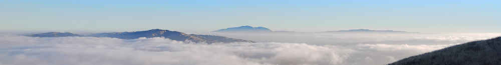
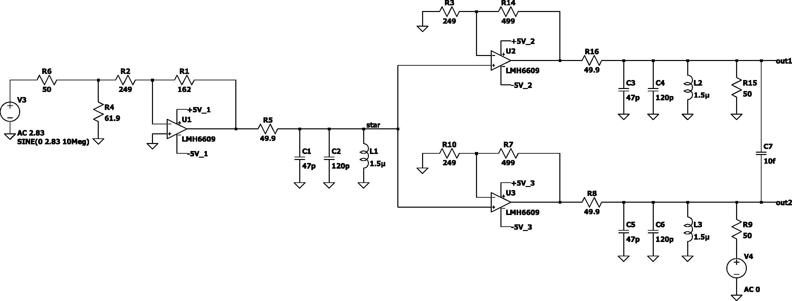

These are the steps I've taken to create a circuit that takes a 10 MHz sine-wave
input and outputs several copies of the same, with a minimum of added phase
noise or distortion. First, select a topology and simulate it. Then, build the
circuit and measure the key specs: noise, crosstalk, distortion.

### Basic Idea

The goal is simple, 10 MHz in, 10 MHz out. Many approaches have been explored:

- Take a differential 10 MHz input signal, pass it through a difference
  amplifier, output a single ended signal.

- Start with 20 MHz, pass it through a flip-flop to divide by 2, and filter the
  resulting square wave to kill the harmonics and obtain a sine wave.

- Design a differential amplifier using discrete transistors to drive a signal
  transformer to lower the output impedance.

- Emitter follower, with AC coupled output (series LC).

- Inverting op-amp plus some filtering and the impedance transformer at the
  output.

- Non-inverting op-amp output circuit.

Of these, I have chosen the version that I find easiest to explain to myself: an
inverting buffer drives several non-inverting output drivers. This is shown in
the image below.



A straightforward transient LTspice simulation (`.tran 0 1.5u 0.5u 25p`) shows
that the output amplitude is 1Vrms. In other words, the circuit should *work* as
shown.

In the simulation I used the spice model for the LMH6609 op-amp provided by
Texas Instruments (original model by National Semiconductor). It works just fine
in LTspice except for commenting out a comment. Apparently PSPICE supports the
`/` symbol as comment in addition to the `*` used by LTspice.

### Crosstalk and Pulling

A key spec on any multi-channel instrument is crosstalk: if a signal is injected
in one output, does it show up in the other output?

Notice the `V4` signal source in the LTspice schematic shown above. If we
disable the main signal source `V3` to `AC 0` and enable `V4` as `AC 1`, then an
AC simulation (`.ac dec 200 1k 1G`) shows about 10μV of crosstalk at `out1`.
Including a rough estimate for layout-dependent capacitive coupling between two
outputs directly (e.g. 10fF at `C7`), this rises to 17μV, or about -95 dB.

Assuming the op-amp model is accurate, we can use this result to estimate the
phase pulling between the two outputs. Assume one of the outputs is connected to
an unterminated cable such that the full signal strength---all 1Vrms or +13dBm
of it---comes back in quadrature. The peak amplitude is 2.82 × 17 μV = 48μV.

Adding a small phasor `a` at angle `φ` to a carrier `A` gives a resultant phase
shift `Δφ ≈ (a/A)·sin φ`. The angle `φ` is set by the cable's round-trip delay
plus the coupling path's fixed phase---and since the user can present any
length, the worst case is `φ = 90°` (quadrature), where the interferer is pure
phase: `Δφ = 48 µV / 1.38 V = 35 µrad`.

At 10MHz one period is 100ns spanning 2π rad, so `Δt = Δφ/(2πf) = 34e-6 /
(6.28e7) ≈ 0.55 ps`. The reflection on Ch-2 will cause Ch-1 to move in phase by
less than a picosecond. Pretty good!

### Additive Phase Noise

There are many mechanisms that contribute to the phase noise at our outputs.
Let us immediately ignore the noise of the 10 MHz source and instead focus on
what adds to the source's phase noise.

At large offsets away from carrier, the noise floor is set by op-amp voltage
noise, resistor Johnson noise, and current noise. The same LTspice model from
above (remember to disable `V4` and re-enable `V3`!) can be used to calculate
the voltage noise density at the output, by means of a `.noise V(out1) V3 lin
401 9.9Meg 10.1Meg` simulation directive. At 10 MHz, it reads 9.7 nV/rtHz.
Relative to the 1 Vrms output amplitude, this is a phase noise floor of

```
L = 20 log10(9.7e-9 / 1.00) − 3.01 = −163 dBc/Hz.
```

Note the 3 dB subtracted, due to the fact that the noise decomposes into
components in phase and in quadrature with the carrier phasor. The in-phase part
wiggles the amplitude; the quadrature part wiggles the phase. For additive noise
these are equal in power, so exactly half the noise power becomes phase
modulation.

### Convective Air Currents

Any air moving across the board, whether forced or natural convection, can cause
the temperature of PCB components to fluctuate. Ferrite inductors, such as the
1.5 μH seen in our tank circuit, might have as much as 500 ppm/K of temperature
coefficient. We can step the inductance value in the LTspice simulation to find
about 0.45° of phase change due to 1% change in inductance.

Putting the numbers together, the phase sensitivity is 3.9e-4 rad/K, or, in time
units, about 6.3 ps/K. If we estimate the inductors temperature noise at 1 Hz to
be about 1.5 mK/rtHz, then the phase noise would be

```
L = 20 log10(3.9e-4 * 1.5e-3) - 3.01 = -127 dBc @ 1 Hz offset.
```

That's a significant amount of phase noise, but easily fixed by reducing the air
currents or increasing thermal insulation. The inductor temperature changes are
heavily low-pass filtered by means of the part's thermal inertia. In other
words, above the thermal pole the response falls as `f^{-2}`, so lowering the
corner buys 20 dB per decade of shift.

### Microphonics

Any sound or mechanical vibration modulates the electrical characteristics of
the circuit. Non-NP0 capacitors are particularly affected, so it's important to
verify there's none in the critical signal path.

Inductors are also prone to microphonics, via magnetostrictive modulation of
inductance. The datasheet will most likely not specify it, so instead we take a
wild guess, say 1.5e-4 inductance change per "g" of acceleration.

Reusing the 0.45° per 1% coefficient from the previous section, the phase
sensitivity is 1.2e-4 rad/g, or about 1.9 ps/g. A fan blade-pass tone at 120 Hz
depositing 0.01 g peak gives a peak phase deviation of 1.2 μrad, and a
sinusoidal modulation of peak deviation Δφ produces sidebands at

```
20 log10(1.2e-6 / 2) = -124 dBc.
```
